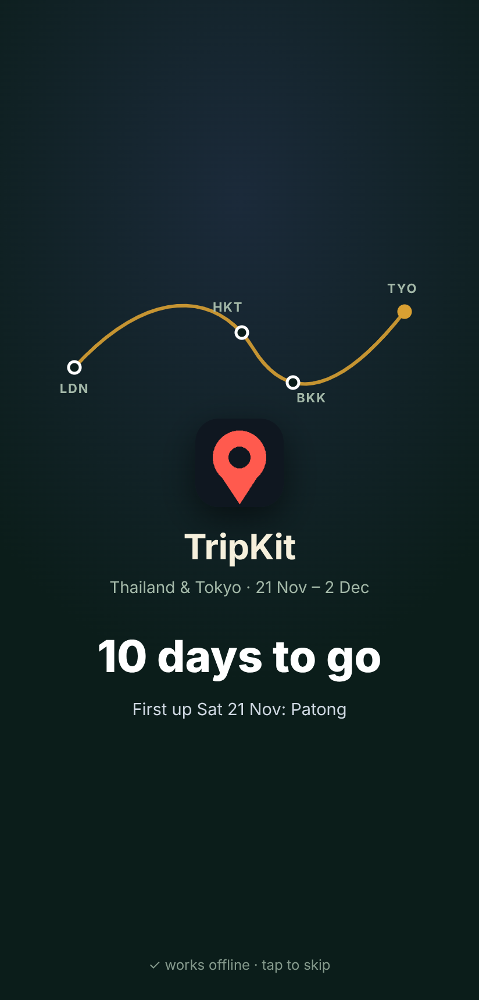
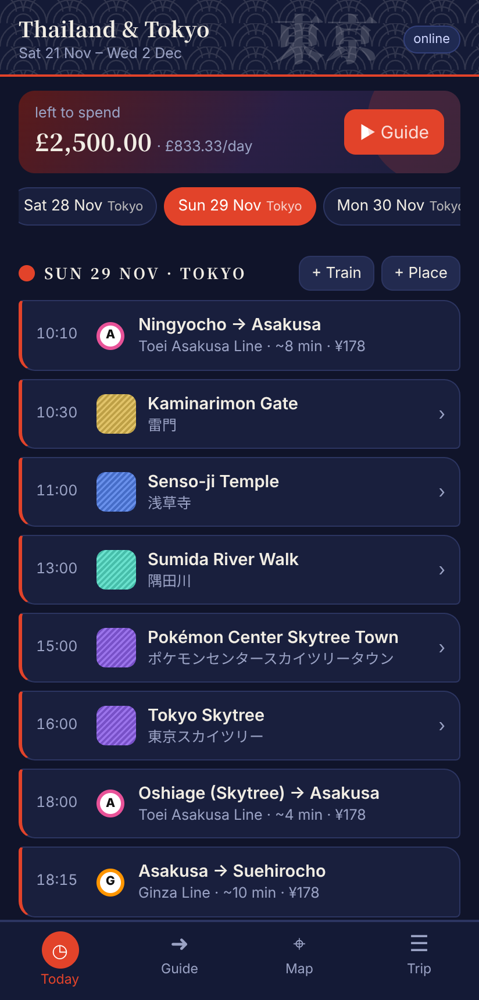
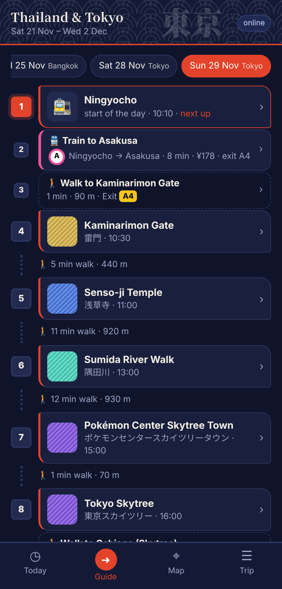
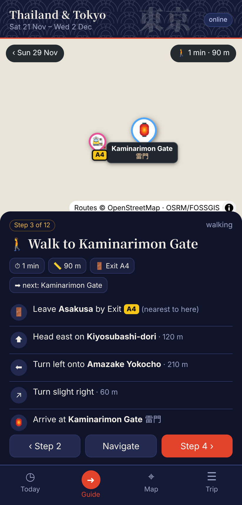
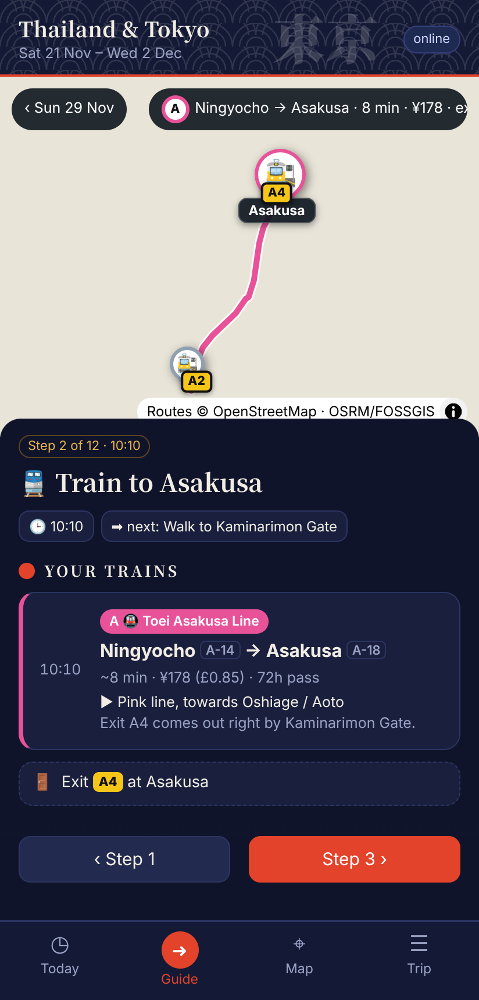
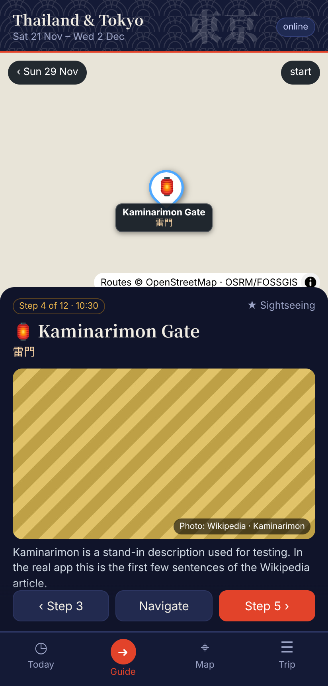
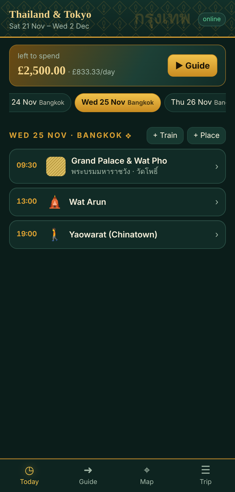
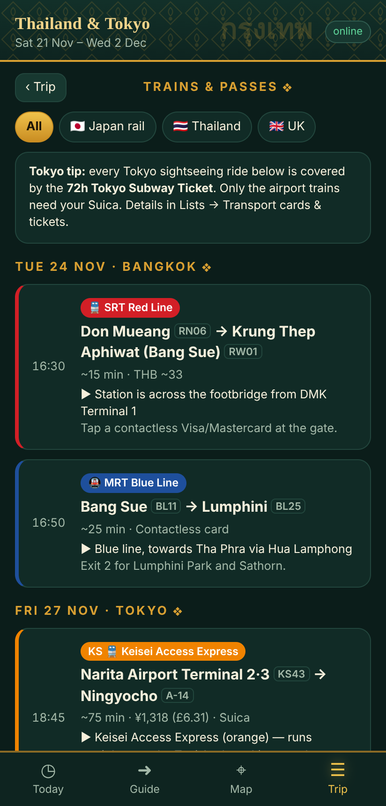

# TripKit

## What is it?

TripKit is a trip planner for Android that **keeps working with no signal**. It was built for a two-week trip through Thailand and Tokyo, where phone data is patchy, metro stations are underground and the map app you rely on stops loading at the worst moment.

Think of it as a printed itinerary that also knows the way:

- **It shows you today.** One screen with the day's plan in time order: places, trains, tickets, with photos and local names (東京スカイツリー, วัดอรุณ) so you can show a driver or read a sign.
- **It walks you through the day, step by step.** The Guide turns the day into steps, each with its own map: walk to the station, which exit to go in at, which train and which direction, which exit to come out of, then turn-by-turn directions to the door.
- **It knows the trains.** Line colours and letters, station codes, journey times and fares in ¥/฿ and £, and whether a Tokyo subway pass is worth buying for your plans.
- **It works offline.** One tap on Wi-Fi saves the maps, photos, routes and station exits for the whole trip onto the phone.
- **It keeps everything else in one place:** flights, hotels, tickets, a budget in your home currency, and checklists (passport, eSIMs, arrival cards).
- **It looks the part.** The colours change with the country you're in that day: indigo and torii red in Japan, emerald and gold in Thailand.

Your trip stays on your phone. There is no account, no server and no tracking. You move it between phones with a backup file.

**→ [Install guide](docs/INSTALL.md)** · **[Changelog](CHANGELOG.md)** · **[Use it for your own trip](docs/TRIP-FORMAT.md)**

> The screenshots use the author's real Thailand and Tokyo itinerary as a demo, **with every flight, hotel, ticket and payment taken out**. The stand-in striped photos and empty map backgrounds come from the test setup, which has no internet. On a phone these show real Wikipedia photos and OpenStreetMap maps.

| Start-up | Today (Tokyo) | Guide | Walk step |
|---|---|---|---|
|  |  |  |  |

| Train step | Place step | Today (Bangkok) | Trains & passes |
|---|---|---|---|
|  |  |  |  |

## Install (Android 6.0 or newer)

1. Download [`dist/TripKit.apk`](dist/TripKit.apk) on your phone.
2. Open it and allow installs from your browser or Files app when Android asks.
3. Tap **Install**. Play Protect may warn about an unknown developer: the app is signed with the repo owner's own key, not a Play Store key.
4. Open TripKit, then on Wi-Fi go to **Trip → Settings → Save cities + my places** to make everything work offline.

Full steps for Pixel, GrapheneOS and Samsung, building the APK yourself, and running it as a web app instead: [docs/INSTALL.md](docs/INSTALL.md). iPhone isn't supported.

## The four tabs

- **Today:** money left, the day chips, and one row per thing you're doing. Tap a place to open its Guide step.
- **Guide:** the day as numbered steps. Each place has a map from the step before, its photo and a short Wikipedia description, and **Mark visited**. Station walks and train rides are their own steps:
  - 🚶 **Walk to the station:** walking time, the exit to go in at, and the train you're catching next.
  - 🚆 **Ride:** the line, direction, stops, changes and the exit to come out of.
  - 🚶 **Walk from the station:** turn-by-turn directions ("Head east on Edo-dori · Turn left onto…") to the door.
- **Map:** emoji pins with English and local names when you zoom in. On a single day's view, the lines follow the real train track, roads and footpaths, and every station and exit is marked. Long-press to add a place; ◎ shows where you are (GPS works offline).
- **Trip:** flights, stays, trains and passes (Japan fares, Suica vs the 72h pass), tickets, budget, checklists, all places and ideas, and settings: backup, offline maps, rates, and the **Look** switch (Country theme or Classic).

## How it works

- **The app** is plain HTML/CSS/JavaScript (`app/`) with no framework and no build step. It runs inside a small Android shell (`apk/`) that serves the files from inside the APK and caches map tiles and photos on the phone.
- **Your data** lives in the phone's local storage. Map tiles, photos and route geometry are cached in the app's private storage.
- **Online lookups** happen only when you have signal, and everything they return is saved for offline use:

| What | Service | Why |
|---|---|---|
| Map tiles | [OpenFreeMap](https://openfreemap.org) (OpenStreetMap data) | the map |
| Photos and descriptions | Wikipedia / Wikimedia Commons | place photos and the "about" text, credited |
| Train lines and station exits | [Overpass API](https://overpass-api.de) (OpenStreetMap) | lines that follow the real track, exit letters |
| Walking and driving routes, directions | [OSRM by FOSSGIS](https://routing.openstreetmap.de) | footpaths, roads, turn-by-turn (max 1 request a second, as their policy asks) |

Nothing about you is sent. These requests carry place names and coordinates from your trip, and a plain `TripKit` User-Agent. Details: [docs/SECURITY.md](docs/SECURITY.md).

## Status

Built for a real trip in Nov–Dec 2026, for a GrapheneOS Pixel with a Samsung as the backup phone. Working: all four tabs, the Guide with walk and ride steps, station exits, offline maps and photos, budget, checklists, backup and import, country themes and the start-up screen.

Not yet:

- **You have to write your own trip file.** There's no in-app wizard yet. Write it by hand or have an AI assistant write it ([docs/TRIP-FORMAT.md](docs/TRIP-FORMAT.md)), then import it.
- **The start-up route graphic and some advice are Thailand/Japan-specific:** the London → Phuket → Bangkok → Tokyo arc, the Japan rail tab and the Suica tips.
- **Some features were only tested against fakes:** the development sandbox couldn't reach the map, Wikipedia, Overpass or OSRM services. Please report anything that looks wrong on a real phone.

Current state and next steps: [docs/HANDOFF.md](docs/HANDOFF.md).

## Development

```
pip install playwright pillow && python -m playwright install chromium
python tests/test_app.py           # 14 browser checks with the network faked
python tests/test_app.py --shots   # also refresh docs/images/
bash apk/build.sh                  # builds dist/TripKit.apk (see the top of the script for the packages it needs)
```

The first `build.sh` creates your own signing key in `apk/signing/`, which is git-ignored. Back that folder up: Android only installs an update over an existing install if it's signed with the same key.

## Licence

No licence has been chosen for TripKit's own code yet (all rights reserved until one is added). Third-party files and data: [LICENSES.md](LICENSES.md).
